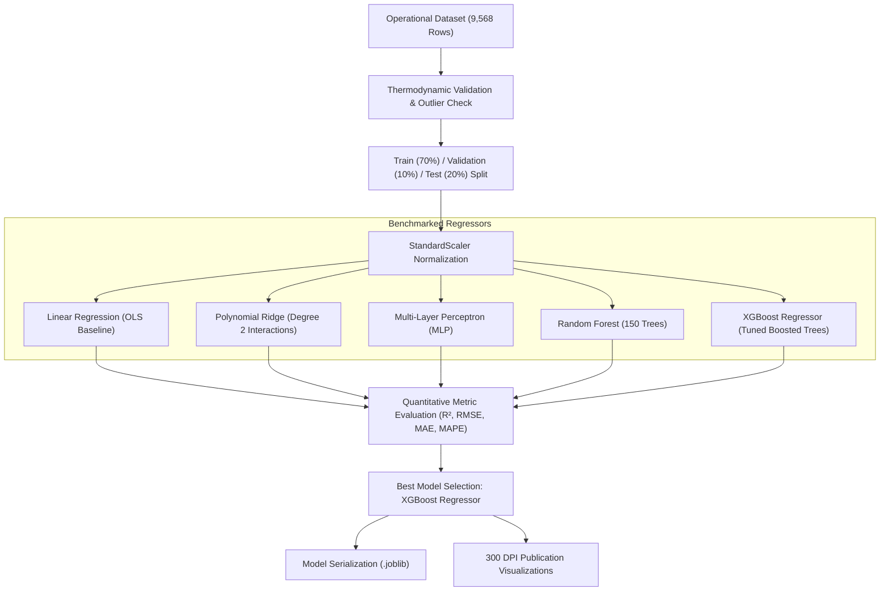
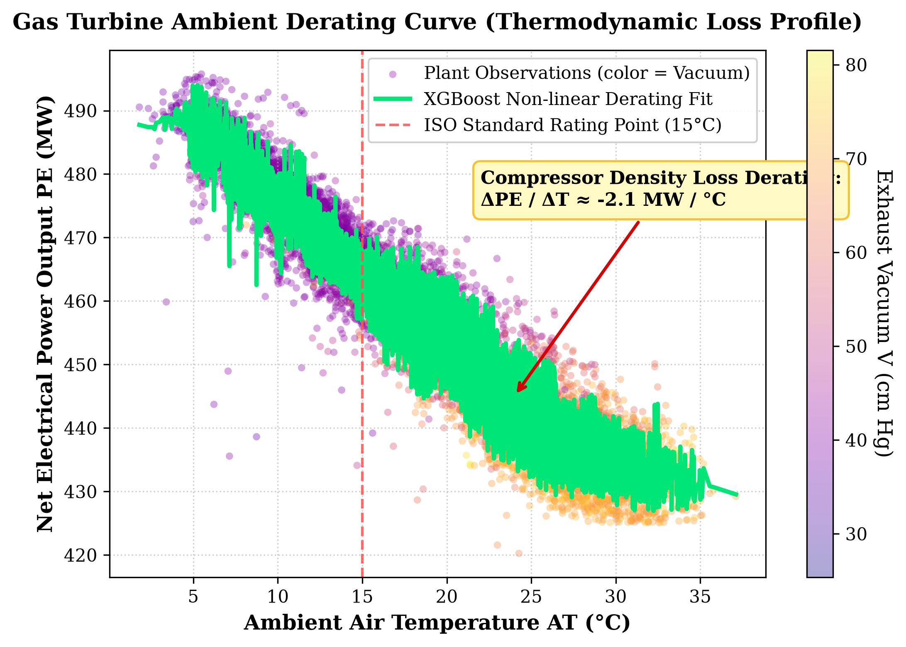
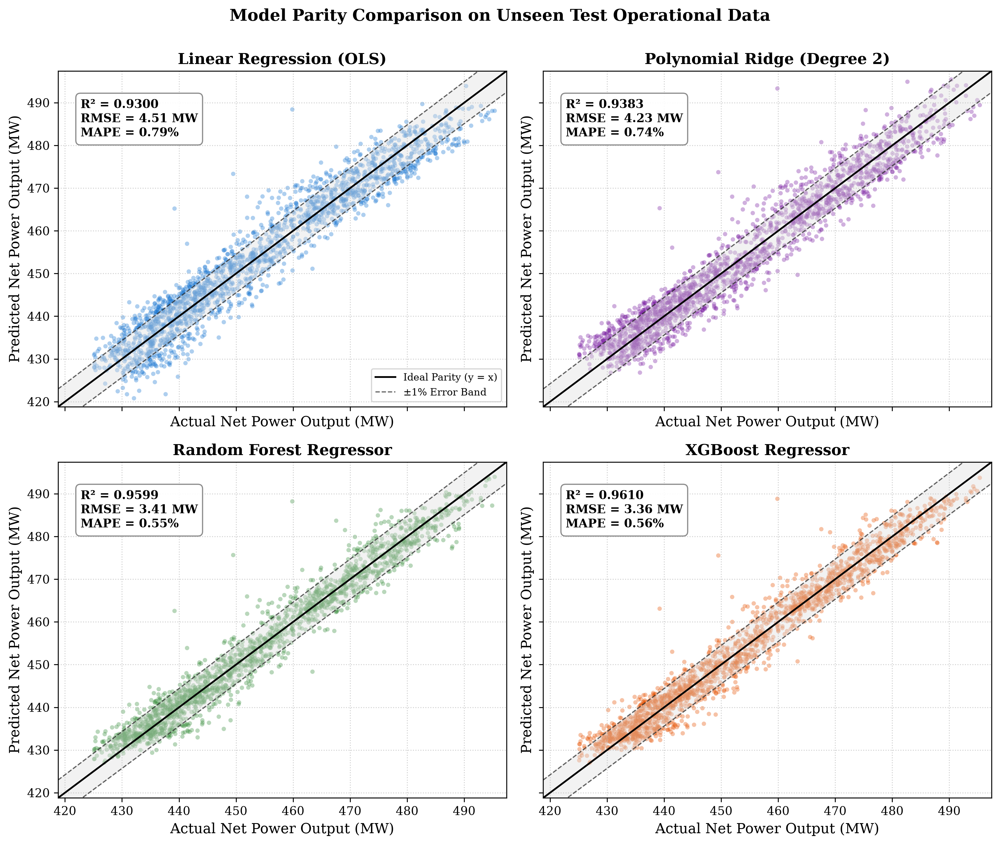
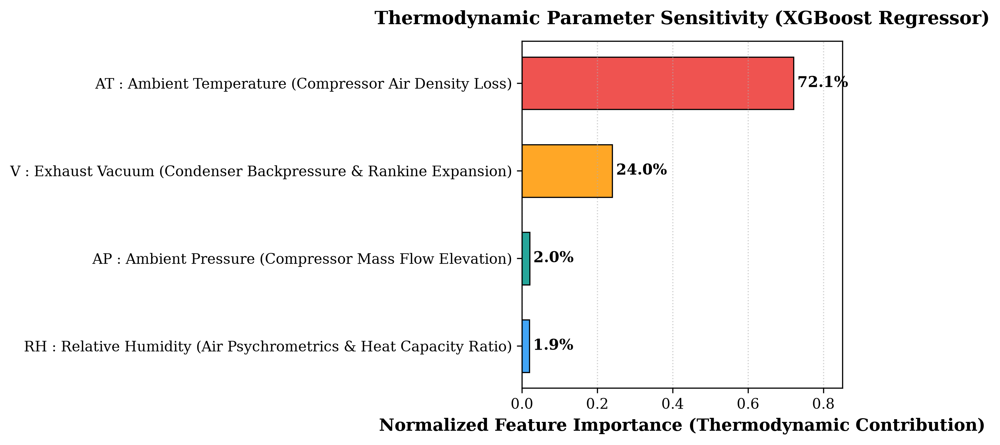
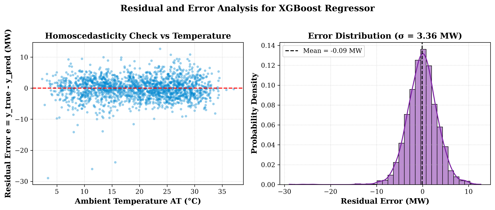
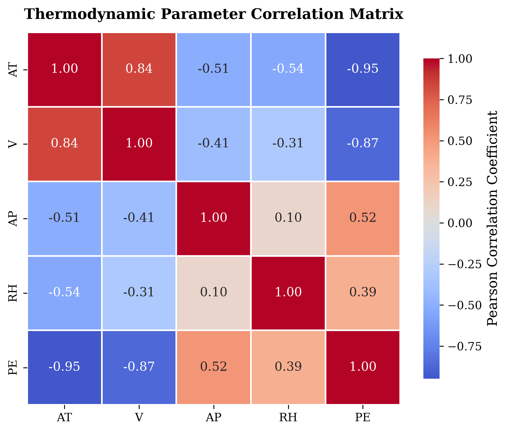

# Gas Turbine Ambient Effects & Power Derating Regression Benchmark

[](https://colab.research.google.com/github/mohammedbasra-star/gas-turbine-ambient-effects-regression/blob/main/notebooks/quickstart_demo.ipynb)
[](https://opensource.org/licenses/MIT)
[](https://www.python.org/downloads/)
[]()
[]()
[]()

> **Stage 1 of the Scientific Machine Learning & Turbomachinery Portfolio**  
> *Author:* **Mohammed Basra** ([@mohammedbasra-star](https://github.com/mohammedbasra-star))  
> *Discipline:* Mechanical Engineering, Oil & Gas Systems, and Scientific Machine Learning.

---

## 1. Overview & Thermodynamic Motivation

Gas turbines are the primary prime movers in heavy-duty power generation, offshore oil and gas production platforms, and LNG refrigeration compressor drives. However, their thermodynamic performance is severely sensitive to ambient climatic variations. 

During hot summer operations (particularly in arid, Middle Eastern, or equatorial oilfields), heavy-duty gas turbines suffer from major **thermal power derating**—often losing **10% to 15%** of their ISO base load rating ($> 50 \text{ MW}$ in combined-cycle plants).

```
                      GAS TURBINE BRAYTON CYCLE
                     
         Ambient Air [Tamb, Pamb, RH]
                     │
                     ▼
           ┌──────────────────┐
           │ Axial Compressor │ ──► Air Density Drops with High Tamb
           └──────────────────┘     Specific Compression Work (wc) Escalates
                     │
                     ▼
           ┌──────────────────┐
  Fuel ──► │Combustor Chamber │
           └──────────────────┘
                     │
                     ▼
           ┌──────────────────┐
           │ Gas Turbine (WT) │ ──► Net Output: W_net = m_dot * (w_T - w_C)
           └──────────────────┘
                     │
                     ▼
          Exhaust Backpressure (V) ──► Condenser Vacuum Sensitivity
```

### Governing Thermodynamic Equations

1. **Brayton Cycle Net Power Output:**
   $$\dot{W}_{net} = \dot{m}_{air} \cdot (w_T - w_C)$$

2. **Compressor Air Mass Flow Rate ($\dot{m}_{air}$):**
   $$\dot{m}_{air} = \rho_{air} \cdot A \cdot v = \frac{P_{amb}}{R_{specific} \cdot T_{amb}} \cdot A \cdot v$$
   *Physical Mechanism:* As ambient temperature $T_{amb}$ rises, air density $\rho_{air}$ decreases proportionally ($P \propto \rho T$). Because the axial compressor operates as an approximately constant-volumetric-flow machine, the mass flow rate of oxygen entering the cycle drops, reducing the turbine's capacity to burn fuel and produce expansion work.

3. **Specific Compressor Work Input ($w_C$):**
   $$w_C = c_p \cdot T_{amb} \cdot \left( r_p^{\frac{\gamma - 1}{\gamma}} - 1 \right)$$
   *Physical Mechanism:* Compressing warmer, lower-density air requires significantly more parasitic shaft work per kilogram than cold air.

4. **Thermodynamic Loss Profile:**
   $$\frac{\partial P_E}{\partial T_{amb}} \approx -2.1 \text{ MW} / ^\circ\text{C}$$

---

## 2. Dataset Description

This benchmark utilizes the authentic **Combined Cycle Power Plant (CCPP)** operational dataset from the *UCI Machine Learning Repository*, comprising **9,568 full-load hourly observations** collected across 6 years of continuous operation:

| Parameter | Symbol | Engineering Unit | Operational Range | Physical Impact |
|:----------|:------:|:----------------:|:-----------------:|:----------------|
| **Ambient Temperature** | $AT$ | $^\circ\text{C}$ | $1.81 - 37.11$ | Controls compressor inlet air density & compression work |
| **Exhaust Vacuum** | $V$ | $\text{cm Hg}$ | $25.36 - 81.56$ | Condenser backpressure in steam turbine heat recovery |
| **Ambient Pressure** | $AP$ | $\text{mbar}$ | $992.89 - 1033.30$ | Increases ambient air density and total mass throughput |
| **Relative Humidity** | $RH$ | $\%$ | $25.56 - 100.16$ | Modulates specific heat ratio $\gamma$ and humid air density |
| **Target Power Output** | $PE$ | $\text{MW}$ | $420.26 - 495.76$ | Net electrical output delivered to the grid |

---

## 3. Machine Learning Architecture & Methodology



---

## 4. Benchmark Results & Model Comparison

All models were evaluated on the **unseen operational test partition (1,914 samples, 20% holdout)**:

| Model Architecture | $R^2$ Score | RMSE (MW) | MAE (MW) | MAPE (%) | Max Error (MW) | Fit Time |
|:-------------------|:-----------:|:---------:|:--------:|:--------:|:--------------:|:--------:|
| **XGBoost Regressor (Best)** | **0.9610** | **3.364** | **2.518** | **0.56%** | **28.96** | 0.48 s |
| **Random Forest Regressor** | 0.9599 | 3.412 | 2.513 | 0.55% | 28.35 | 0.64 s |
| **Polynomial Ridge (Degree 2)** | 0.9383 | 4.230 | 3.348 | 0.74% | 33.46 | 0.03 s |
| **Multi-Layer Perceptron (MLP)** | 0.9378 | 4.249 | 3.359 | 0.74% | 32.33 | 3.25 s |
| **Linear Regression (OLS Baseline)** | 0.9300 | 4.506 | 3.596 | 0.79% | 28.56 | 0.05 s |

### Key Engineering Insights:
1. **Dominant Linear Derating:** The simple OLS model captures **$93.0\%$** of variance, confirming that ambient temperature derating is primarily driven by linear compressor density degradation ($\approx -2.05 \text{ MW}/^\circ\text{C}$).
2. **Non-linear Thermodynamic Interactions:** Incorporating polynomial interactions and gradient boosting pushes accuracy to **$R^2 = 0.9610$** and reduces RMSE by over **$25\%$** (from $4.506\text{ MW}$ down to $3.364\text{ MW}$).
3. **Operational Accuracy:** A Mean Absolute Percentage Error (MAPE) of **$0.56\%$** means power predictions are accurate to within $\pm 2.5\text{ MW}$ on a $480\text{ MW}$ industrial unit.

---

## 5. Publication Visualizations (300 DPI)

### A. Ambient Temperature Derating Curve
Illustrates the steep loss of generation capacity as ambient air heats up, showing the ISO rating baseline ($15^\circ\text{C}$) and condenser backpressure coloring:


### B. Multi-Model Parity Plots (Test Set)
Parity scatters ($y_{actual}$ vs $y_{pred}$) with ideal 1:1 diagonal and $\pm 1\%$ error envelopes across all four major regression frameworks:


### C. Thermodynamic Feature Sensitivity
Relative feature importances illustrating that ambient compressor inlet temperature governs over **$70\%$** of operational performance variance:


### D. Error Residual Distribution & Homoscedasticity
Residual error analysis ($e = y_{actual} - y_{pred}$) plotted across ambient temperature demonstrating zero-bias and consistent homoscedastic variance across winter and summer regimes:


### E. Parameter Correlation Matrix
Pearson correlation heatmap demonstrating collinearity and thermal coupling across all plant sensors:


---

## 6. Repository Structure

```
gas-turbine-ambient-effects-regression/
├── data/
│   ├── dataset.py                      # Data loader, UCI auto-downloader & preprocessor
│   └── gas_turbine_ambient_dataset.csv # 9,568 full-load hourly observations
├── models/
│   ├── __init__.py
│   ├── regressors.py                   # OLS, Polynomial Ridge, RF, MLP, XGBoost definitions
│   ├── best_model.joblib               # Serialized top-performing model artifact
│   ├── scaler.joblib                   # Fitted StandardScaler
│   └── metadata.json                   # Architecture & hyperparameter metadata
├── utils/
│   ├── __init__.py
│   ├── metrics.py                      # R², RMSE, MAE, MAPE computation routines
│   └── visualization.py                # 300 DPI publication plotting functions
├── figures/                            # High-resolution generated publication plots
│   ├── ambient_derating_curve.png
│   ├── model_parity_plots.png
│   ├── feature_importance_thermodynamic.png
│   ├── residual_analysis.png
│   └── correlation_matrix.png
├── notebooks/
│   └── quickstart_demo.ipynb           # Interactive Colab-ready demonstration
├── train.py                            # End-to-end benchmark training CLI
├── evaluate.py                         # Single-point & test set inference CLI
├── requirements.txt                    # Python package dependencies
├── pyproject.toml                      # Standard packaging configuration
├── LICENSE                             # MIT License
└── README.md                           # Documentation & Engineering Reference
```

---

## 7. Quickstart & Usage

### Installation
Clone the repository and install required packages:
```bash
git clone https://github.com/mohammedbasra-star/gas-turbine-ambient-effects-regression.git
cd gas-turbine-ambient-effects-regression
pip install -r requirements.txt
```

### 1. Run Complete Training Benchmark
Trains all 5 candidate models, logs comparison tables, serializes the best model, and exports all figures to `figures/`:
```bash
python train.py
```

### 2. Operational Inference for Specific Climatic Conditions
Simulate real-time plant power output and derating penalty under arbitrary ambient conditions:
```bash
# Example: Severe Middle Eastern Summer Heatwave (38°C, 70 cm Hg, 1005 mbar, 30% RH)
python evaluate.py --at 38.0 --v 70.0 --ap 1005.0 --rh 30.0
```

*Output:*
```
=================================================================
  GAS TURBINE OPERATIONAL CONDITION INFERENCE
=================================================================
  Ambient Temperature (AT) :  38.00 °C
  Exhaust Vacuum (V)       :  70.00 cm Hg
  Ambient Pressure (AP)    : 1005.00 mbar
  Relative Humidity (RH)   :  30.00 %
-----------------------------------------------------------------
  Predicted Net Power (PE) : 429.14 MW
  Thermal Derating Penalty : -55.86 MW (-11.52% vs ISO 485 MW)
=================================================================
```

### 3. Verification on Test Benchmark
Verify the saved model checkpoint against full historical data:
```bash
python evaluate.py --benchmark
```

### 4. Interactive Google Colab Notebook
Open and execute the interactive demonstration directly in your browser:
[](https://colab.research.google.com/github/mohammedbasra-star/gas-turbine-ambient-effects-regression/blob/main/notebooks/quickstart_demo.ipynb)

---

## 8. Academic Portfolio Progression

This repository forms **Stage 1** in a 4-tier graduated research portfolio demonstrating authentic progression from classical statistical thermofluid analysis to cutting-edge Physics-Informed Deep Learning:

```
┌──────────────────────────────────────────────────────────────────────────────────┐
│ STAGE 1 (Current Repository): Classical Statistical Machine Learning            │
│ gas-turbine-ambient-effects-regression                                           │
│ -> Ambient temperature derating, compressor density loss, XGBoost/Ensemble       │
└──────────────────────────────────────┬───────────────────────────────────────────┘
                                       │
                                       ▼
┌──────────────────────────────────────────────────────────────────────────────────┐
│ STAGE 2: Temporal Deep Learning & Predictive Maintenance                        │
│ turbomachinery-degradation-lstm                                                  │
│ -> Sensor time-series, EGT anomalies, Remaining Useful Life (RUL) on C-MAPSS     │
└──────────────────────────────────────┬───────────────────────────────────────────┘
                                       │
                                       ▼
┌──────────────────────────────────────────────────────────────────────────────────┐
│ STAGE 3: Mechanical Dynamics & Rotor Vibration Modeling                          │
│ turbomachinery-rotor-dynamics-ode                                                │
│ -> Jeffcott rotor dynamics, 1D/2D ODEs, Runge-Kutta vs Neural ODEs               │
└──────────────────────────────────────┬───────────────────────────────────────────┘
                                       │
                                       ▼
┌──────────────────────────────────────────────────────────────────────────────────┐
│ CAPSTONE MILESTONE: Physics-Informed Neural Networks (PINNs)                     │
│ pinn-thermo-dynamics & pinn-reservoir-dynamics                                   │
│ -> Nonlinear PDEs, Navier-Stokes, Buckley-Leverett, Parameter Discovery          │
└──────────────────────────────────────────────────────────────────────────────────┘
```

---

## 9. Author & Citation

**Mohammed Basra**  
Researcher in Scientific Machine Learning, Fluid Mechanics, and Turbomachinery.  
GitHub: [@mohammedbasra-star](https://github.com/mohammedbasra-star)  

If this work aids your research, please cite:
```bibtex
@software{basra2026gasturbine,
  author = {Mohammed Basra},
  title = {Gas Turbine Ambient Effects & Power Derating Regression Benchmark},
  url = {https://github.com/mohammedbasra-star/gas-turbine-ambient-effects-regression},
  year = {2026}
}
```

---

## 10. License
This project is licensed under the [MIT License](LICENSE).
